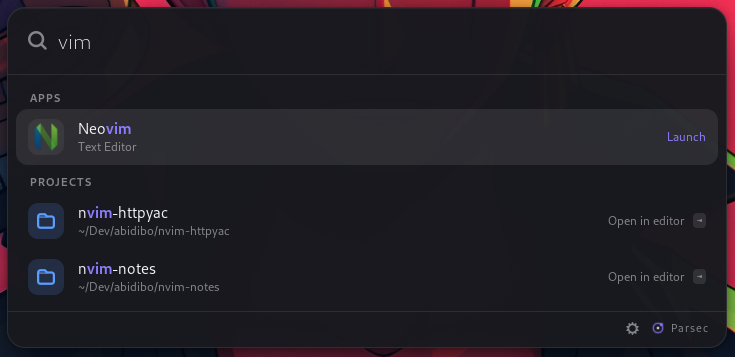

# Parsec

A personal launcher for GNOME. Press a key, type, press Enter.



Apps, your git projects with their branches, commits and files, a shell
runner, GitHub repositories and pull requests, clipboard history with pinned
snippets, KeePass entries, files, SSH hosts, Docker containers and systemd
services, all in one dark panel that follows you between machines: everything
that depends on the host (editor, terminal, project folders, database path)
is detected on first run, written to a config file, and editable in a settings
window. An optional GNOME Shell extension adds open windows to the results
and pastes straight into the window you came from. Ctrl+Enter pipes a
result into the next verb (a repository into `qr`, a diff into `ask`), and
a Quick Look pane previews files, projects and clipboard entries as you
move through them.

Rust, GTK 4, libadwaita. Wayland first.

## Contents

- [Requirements](#requirements)
- [Install](#install)
- [First run](#first-run)
- [Using it](#using-it)
- [Settings and configuration](#settings-and-configuration)
- [GNOME Shell extension](#gnome-shell-extension)
- [Plugins](#plugins)
- [Styling](#styling)
- [Command line](#command-line)
- [Development](#development)
- [Troubleshooting](#troubleshooting)
- [Security notes](#security-notes)
- [License](#license)

## Requirements

Runtime:

| What | Why | Needed |
|---|---|---|
| GNOME 46 or newer, Wayland session | the launcher and its hotkey | yes |
| GTK 4.14+, libadwaita 1.5+ | the UI, already on any GNOME 46 system | yes |
| `wl-clipboard` | copying results and clipboard history | yes |
| `xclip` | clipboard history on GNOME 46 and 47 (see [below](#clipboard-on-gnome-46-and-47)) | recommended |
| `plocate` | files anywhere on disk; Tracker alone covers Documents, Downloads, Desktop and media | recommended |
| `docker`, `systemctl` | the `dk` and `svc` verbs | optional |
| `gh` (GitHub CLI), logged in | the `gh` and `pr` verbs | optional |
| the Parsec Shell extension | window switching, paste into the previous window, event-driven clipboard on any GNOME (see [below](#gnome-shell-extension)) | optional |

Build, only when no prebuilt binary fits your system (the installer handles it):

| Distribution | Packages |
|---|---|
| Ubuntu / Debian | `build-essential pkg-config libgtk-4-dev libadwaita-1-dev` |
| Fedora | `gcc pkg-config gtk4-devel libadwaita-devel` |
| Arch | `base-devel pkgconf gtk4 libadwaita` |

plus a Rust toolchain, 1.82 or newer, from <https://rustup.rs>.

## Install

```sh
curl -fsSL https://raw.githubusercontent.com/abidibo/parsec/main/install.sh | bash
```

The script:

1. installs GTK, libadwaita and `wl-clipboard` with `apt`, `dnf` or `pacman` if they are
   missing. It asks for your password only then
2. downloads the prebuilt binary from the [latest release](https://github.com/abidibo/parsec/releases/latest)
   for your processor, x86_64 or ARM64, and checks its SHA-256 checksum
3. installs it to `~/.local/bin/parsec` and the icon to your icon theme
4. adds an autostart entry so the daemon starts at login
5. binds **Ctrl+Space** to toggle the launcher, as a GNOME custom shortcut, unless that
   shortcut is already taken
6. (re)starts the daemon

It takes a few seconds and needs no Rust. If no binary fits your system, the script builds
Parsec from source instead. It installs the build packages and, if your Rust is missing or
older than 1.82, installs Rust with [rustup](https://rustup.rs). If you already use rustup, it
leaves your default toolchain alone.

The optional tools in [Requirements](#requirements) (`xclip`, `plocate`, `gh`...) are not
installed for you. On Ubuntu: `sudo apt install xclip plocate gh`.

Run the same command again to update; it also refreshes the Shell extension if you use it.
Settings:

| Variable | Effect |
|---|---|
| `PARSEC_HOTKEY='<Super>space'` | Bind another key, or pass an empty value to skip the shortcut. |
| `PARSEC_EXTENSION=1` | Also install the [Shell extension](#gnome-shell-extension). |
| `PARSEC_VERSION=1.1.0` | Install a specific release instead of the latest. |
| `PARSEC_FROM_SOURCE=1` | Build from source even when a binary is available. |

For example:

```sh
curl -fsSL https://raw.githubusercontent.com/abidibo/parsec/main/install.sh | PARSEC_EXTENSION=1 bash
```

You can change the shortcut later in GNOME Settings › Keyboard › Custom Shortcuts.

From a clone, `./install.sh` always builds and installs that checkout.

`~/.local/bin` must be on your `PATH` for `parsec` to work from a shell; the
hotkey uses the full path and works regardless.

To uninstall:

```sh
curl -fsSL https://raw.githubusercontent.com/abidibo/parsec/main/install.sh | bash -s -- --uninstall
```

It stops the daemon and removes the binary, the desktop and autostart entries, the icon, the
shortcut and the Shell extension. Your settings in `~/.config/parsec` and data in
`~/.local/share/parsec` stay; delete them by hand if you want a clean slate.

### Releasing

Bump `version` in `Cargo.toml`, commit, then tag and push without a `v` prefix:

```sh
git tag 1.1.0 && git push origin 1.1.0
```

The [release workflow](.github/workflows/release.yml) builds x86_64 and ARM64 binaries on
Ubuntu 24.04 and publishes them with their checksums. It fails if the tag and `Cargo.toml`
disagree.

## First run

Press Ctrl+Space. The panel opens empty. Type a few letters of an application
name and press Enter.

On its first start Parsec looks around and writes
`~/.config/parsec/config.toml`:

- editor: `$VISUAL`, then `$EDITOR`, then an installed GUI editor (VS Code,
  Zed, GNOME Text Editor...), then a terminal one (nvim, vim, helix...).
  Terminal editors are launched inside your terminal, in the project folder.
- terminal: `$TERMINAL`, then kitty, wezterm, alacritty, foot, ptyxis,
  gnome-terminal, konsole, xfce4-terminal, xterm, each with the right
  working-directory flag.
- project folders: whichever of `~/Dev ~/dev ~/Projects ~/projects ~/Code
  ~/code ~/src ~/work ~/repos ~/git` exist.
- KeePass database: the first `.kdbx` found in your home or one level down.

Check the result with `parsec config`, or open the settings (see below) and
adjust. Nothing is hard-wired: a different machine gets a different file.

## Using it

Type to search. Results come from several providers at once; a leading verb
narrows the search to one of them.

| Type | Result |
|---|---|
| `fire` | applications, fuzzy matched, ranked by how often and how recently you pick them |
| `myproj` | git repositories under your project folders |
| `$ ls -la` | a shell command: runs in a terminal that stays open; `$` alone lists your command history |
| `gh name` | your GitHub repositories |
| `pr` | your open pull requests |
| `cb text` | clipboard history |
| `kp name` | KeePass entries, after unlocking |
| `g query`, `w query` | custom shortcuts: Google and Wikipedia by default, add your own |
| `= 2*(3+4)` | the calculator plugin, once installed |
| `f name` | files by name, through GNOME's Tracker index and plocate |
| `ssh host` | hosts from `~/.ssh/config`; Enter connects in your terminal |
| `dk name` | Docker containers: shell, logs, start, stop, restart |
| `svc name` | systemd services, user and system: status, logs, restart |
| `win title` | open windows, with the Shell extension; also mixed into plain queries |
| `sys dark` | system toggles and commands: dark style, do not disturb, Wi-Fi, mute, lock, suspend, settings panels… |
| `ip` | your local, public and VPN addresses; Enter copies |
| `img 50%` | resize, convert, crop or trim the images you copied in Files |
| `qr text` | a QR code of the text, drawn as you type; `qr` alone encodes the clipboard; `qr wifi` lets a phone join your Wi-Fi |
| `h text` | your browser's history and bookmarks; bookmarks also show in plain queries |
| `ps name` | your processes, heaviest first: terminate, kill, watch; `ps :3000` finds who listens on a port |
| `parsec` | Parsec's own entries: settings, quit, update when one is available |

Keys:

| Key | Action |
|---|---|
| ↑ ↓ | move the selection |
| Tab / Shift+Tab | cycle the selected row's actions; rows with several show a ⇥ mark |
| Enter | run the action shown on the right |
| Ctrl+Enter | pipe the selected row into the next verb (see [Pipes](#pipes)) |
| Alt+1 … Alt+9 | run the nth result; hold Alt to see the numbers |
| Esc | close, cancel a password prompt or a running pipe stage, or step out of a list |
| ⌫ on an empty box | leave a keyword mode, step out of a list, or undo the last pipe stage |
| Ctrl+, | settings |

Opening the launcher with nothing typed shows the things you have picked
before. Word verbs need a space (`gh foo`; `ghost` searches apps). Symbol
verbs don't (`$ls`).

### Pipes

Ctrl+Enter on a row hands what it holds to the next verb you type. The
row becomes a chip in the search bar, the box empties, and the next
verb gets it as input. Chain as many stages as you like; Backspace on
the empty box takes the last one back, Enter on the final stage runs it.

What a row hands on is what it would copy or open: a file's or project's
path, a clipboard entry, a URL, a commit hash, a container id, a plugin's
answer. Rows whose Enter is a password hand on nothing, and secrets never
flow. A verb receives the input like this:

- `{}` in what you type is replaced by it: `$ docker logs {} --tail 50`
- otherwise it is added after what you typed: `qr` alone encodes it,
  `tr >en` translates it
- `$` takes it on stdin when there's no `{}` (`$ jq .data`, `$ wc -l`),
  and plugins that ask for it (`input = true`) get it apart from the text
- a folder (a project, a folder from `f`) piped into `$` without `{}` is
  where the command runs: `parsec` ⇢ `$ git status` runs in the project

A `$` stage runs when you commit it, in the background, and hands on its
output (up to 1 MB, two minutes at most; Esc stops it). It is the only way
a command runs before you press Enter on it. Commands run in your home
folder unless a folder was piped in.

| Pipe | What happens |
|---|---|
| `gh parsec` ⇢ `qr` | the repository's URL as a QR code, for your phone |
| `cb token` ⇢ `dev` | decode a JWT or base64 you copied earlier |
| `cb` ⇢ `tr >en` ⇢ `qr` | a copied note, translated, on your phone |
| `parsec` ⇢ `$ git diff --staged` ⇢ `ask write a commit message` | a commit message from the project's staged changes |
| `dk postgres` ⇢ `$ docker logs --tail 80 {}` ⇢ `ask why does it crash?` | logs straight to Claude |
| `f invoice.pdf` ⇢ `$ pdftotext {} -` ⇢ `ask total and due date` | read a PDF |
| `parsec` ⇢ `$ git log -1 --format=%s` ⇢ `tr >it` | the project's last commit, in Italian |

Verbs that answer slowly (`tr`, `ask`) open their answer with Enter as
usual; Ctrl+Enter on the answer passes it on.

`parsec query --input <text> <verb ...>` runs a stage from a shell, with
`--input -` reading stdin; each row shows what it would hand on.

### Quick Look

When the selected row has something to show, a pane slides in beside the
results and follows the selection:

- files and folders (`f`, a project's Files): images, the first lines of
  text and code, GNOME's thumbnail for PDFs, videos and documents, a
  folder's contents; type, size, dimensions and age
- clipboard entries: the whole text, a swatch for CSS colours (`#8b7cff`,
  `rgb(…)`), length and when it was copied
- projects: the README, branch, last commit and uncommitted changes
- plugin rows that carry a `preview` (see [Writing one](#writing-one))
- the input of a pipe, in full

Files are read off the main thread, scaled down, and cached until the
launcher opens again. READMEs and `.md` files show rendered: headings,
emphasis, code, lists, quotes and links (click to open). Images and raw
HTML are left out, and each table row becomes one line.

### Shell runner and history

`$ cmd` runs the command in your terminal and drops into a shell afterwards,
so the output stays on screen; Tab runs it in the background or copies it.
`$` alone lists your command history, newest first, and `$ text` matches
against it while still offering the typed text as the first row. Enter on a
history row runs it the same way. History comes from `~/.zsh_history`,
`~/.bash_history`, fish's history file and `$HISTFILE`, whichever exist,
plus everything run through Parsec itself. Duplicates collapse into one
row with a count; commands shorter than three characters and `exit`,
`clear` and friends are skipped.

Files are re-read only when they change, checked when you type. Shells
write their history at their own pace, often at exit, so the last few
commands of a terminal that is still open may not show until it closes;
`setopt INC_APPEND_HISTORY` in zsh or `PROMPT_COMMAND='history -a'` in
bash makes them immediate. Parsec's own runs are recorded at once in
`~/.local/share/parsec/shell_history.json`, mode 0600. Settings ›
Providers › Shell history turns it off or points at other files.

### Images

Copy one or more images in Files, copy a path to one, or copy an image
itself (a screenshot, a picture from a web page), then:

| Type | Result |
|---|---|
| `img 50%`, `img 800`, `img x600`, `img 800x600` | half size, 800 px wide, 600 px high, fit inside 800×600 |
| `img jpg`, `img png`, `img webp` | convert |
| `img crop 1:1`, `img crop 16:9` | largest centred area of that shape |
| `img crop 1200x630` | centred crop, then exactly that size |
| `img trim` | cut away plain borders and empty margins |
| `img rotate`, `img rotate left`, `img flip`, `img flip v` | turn or mirror |
| `img strip` | remove metadata such as location and camera |

Steps combine in the order you type them: `img crop 1:1 50% webp`. `img`
alone lists the common ones. The row shows the result before you commit,
e.g. `photo.jpg · 4032×3024 → 2016×1512 JPEG`.

For files, Enter saves the results next to the originals as
`photo-50.jpg`, `photo-1x1.jpg` or `photo.webp`, never over an existing file.
With a single file, Tab copies the result to the clipboard instead, ready to
paste into a chat or a document, or opens the original in an image editor
you have installed. For an image on the clipboard it's the other way round:
Enter puts the result back on the clipboard (screenshot, `img trim`, paste),
and Tab saves it to Pictures as `clipboard-<time>.png`. Phone photos are turned upright first, and every result is
saved without the original's metadata.

Images go through gdk-pixbuf, which GTK already brings: PNG, JPEG, TIFF and
BMP work everywhere, WebP when `webp-pixbuf-loader` is installed (most GNOME
systems have it). JPEG and WebP are saved at quality 85. Animated GIFs keep
their first frame only.

### IP addresses

`ip` lists the addresses worth knowing: the local one of the network card
that reaches the internet (with its gateway), your public IPv4 and IPv6,
any VPN with whether it carries all your traffic or only some, then other
connected cards. `ip vpn`, `ip public` or `ip wifi` filter. Enter copies the
address; Tab copies it with its prefix (`192.168.1.20/24`) or looks a public
one up on ipinfo.io.

Bridges, Docker networks and other virtual interfaces are left out: Parsec
asks the kernel what each interface is rather than guessing from its name.
The public address is asked from api.ipify.org only when you type `ip`, and
kept for five minutes; turn that off in Settings › Providers or with
`[ip] public_lookup = false`. Needs `ip` from iproute2, which every
distribution ships; VPN names come from NetworkManager when it's there.

### QR codes

`qr` followed by text draws its QR code large in the launcher, updating as
you type; `qr` alone encodes whatever text is on the clipboard, handy for
sending a link to your phone. Enter copies the code as an image, Tab saves
it as `~/Pictures/qr-<time>.png` or copies the text. Codes are always black
on white with a margin, which phone cameras read best, and hold up to about
2,900 bytes. A password Parsec just copied from KeePass is never drawn.

`qr wifi` draws the code a phone camera joins your current Wi-Fi network
with: no typing the password for guests. `qr wifi office` picks a saved
network whose name contains "office". The network name, security and
password come from NetworkManager (`nmcli`); Tab also offers *Copy password*,
kept out of the clipboard history and cleared after 30 seconds. Enterprise
(802.1X) networks have no password to share, so they get a message instead.

### Browser history and bookmarks

`h` alone lists the pages you visited most recently; `h text` matches titles
and addresses, favouring pages you visit often and bookmarks. Bookmarks also
show in plain searches, matched by name and ranked below apps. Enter opens the
page in the browser it came from; Tab copies the URL.

One browser is read at a time: your default browser, or the one set in
Settings › Providers › Browser. Supported: Brave, Chrome, Chromium, Vivaldi,
Edge (the Chromium family) and Firefox, LibreWolf, Zen (the Firefox family),
native, Flatpak or Snap. For anything else built on one of the two, point
`path` at its profile folder (the one holding `History` or `places.sqlite`).
The profile is the one the browser used last unless you name one.

A running browser keeps its database locked, so Parsec copies it to a private
folder under `$XDG_RUNTIME_DIR`, which lives in memory, reads the 10,000 most
recent pages and deletes the copy. It reads again when the files change, at
most once a minute, in the background. Private windows leave no history, so
they never show up here.

### Projects

Actions: open in editor, open a terminal there, open the folder, copy the
path. Folders are rescanned every two minutes and whenever the setting changes.

Further down the Tab cycle, three actions open a list instead of leaving:

- *Branches*: local then remote, newest commit first, the current one
  marked. Enter switches to it in your terminal, so a failed switch stays
  on screen. Tab copies the name.
- *Commits*: the last fifty. Enter shows the diff in your terminal, Tab
  copies the hash.
- *Files*: the repository folder. Folders open further, files open in
  their application or your editor; both copy the path.

While a list is open its name sits in the chip, the search box filters it,
and Backspace or Esc step back out. Lists are loaded when opened, never
before, so nothing is computed for projects you never expand. Any provider
or plugin can offer such lists, see [Plugins](#plugins).

### Clipboard history and snippets

Enter copies an entry back to the clipboard; paste it with Ctrl+V in the app
you're in. With the [Shell extension](#gnome-shell-extension) Enter pastes
it straight into the window you came from (Ctrl+Shift+V in terminals) and
*Copy* moves to Tab. Tab also offers *Pin as snippet* and *Delete*. Pinned entries never
expire and show a star. History lives in `~/.local/share/parsec/clipboard.json`
with mode 0600.

#### Clipboard on GNOME 46 and 47

GNOME before 48 lacks the Wayland data-control protocol, so a background
process cannot be told about clipboard changes. Parsec then reads the
clipboard once a second through `xclip` and XWayland, which the compositor
keeps in sync with the Wayland clipboard. Install `xclip` or history stays off,
with a line in the log saying so. On GNOME 48+, sway or Hyprland it is
event-driven and needs nothing extra. The [Shell extension](#gnome-shell-extension)
makes it event-driven on any GNOME and replaces `xclip`.

### Files

`f name` searches file names. Two sources are merged: GNOME's Tracker index,
which follows Documents, Downloads, Desktop and media within seconds, and
plocate, which covers the whole disk but refreshes nightly (`sudo updatedb`
forces it). Every word you type must appear; the result is ranked fuzzily on
the file name with a boost for recently modified files. Actions: open, show
in folder, open a terminal there, open in editor, copy path. Settings ›
Providers limits the search to folders, excludes folder names, and toggles
hidden files and each source. Files are also suggested when a plain query
matches nothing else.

### Windows

With the [Shell extension](#gnome-shell-extension) running, open windows are
results too. A plain query matches window titles and application names
alongside everything else, so `fire` offers the Firefox window you already
have next to a fresh launch. `win` on its own lists every window, most
recent first; `win mail` filters. Enter switches to the window, changing
workspace if needed; Tab offers *Close window*.

An app with windows open says *Running* under its name, and Tab on it offers
*Quit*, which works like Quit in the dash (the app may still ask to save),
and *Force quit*, which sends SIGKILL to the processes owning its windows.
Enter still launches it.

### System controls

`sys` lists toggles with their current state and one-shot commands. Enter on
a toggle flips it: dark style, do not disturb, night light, Wi-Fi (`nmcli`),
Bluetooth (`bluetoothctl`), speaker and microphone mute (`wpctl`). Commands:
lock, suspend, log out, restart, power off (the last three go through
GNOME's own confirmation dialog), empty trash, GNOME's screenshot tool, and
*GNOME Settings*, whose Tab action opens a list of panels to drill into.
Rows whose program is missing are not shown.

### Processes

`ps name` lists your own processes, highest CPU share first, with PID,
memory and command line. Enter sends SIGTERM; Tab offers SIGKILL, *Watch*
(`htop -p` or `top -p` in your terminal) and *Copy PID*. Matching prefers
the process name over the command line.

`ps :3000` finds the process listening on TCP port 3000, or on any port
starting with those digits; `ps :` lists every listening port. Enter still
sends SIGTERM, and Tab adds *Open in browser* (`http://localhost:3000`).
Linux shows which process holds a socket only to its owner and root, so
other users' ports are named another way: ports a Docker container publishes
show the container, with the `dk` actions (shell, logs, restart, stop);
the rest show the user they run as, such as `ollama` or `root`, and can
only be opened. Process rows show their ports in the subtitle.

### Infrastructure

- `ssh host`: aliases from `~/.ssh/config` with their user and host name.
  Enter opens your terminal running `ssh host`; an unknown name connects
  to it anyway.
- `dk name`: Docker containers, running ones first. Shell opens a terminal
  inside the container, Logs follows them, then restart, stop or start.
- `svc name`: systemd services, user and system. Status and Logs open in
  the terminal; restart, stop and start run directly for user units and
  through `sudo` in a terminal for system units.

### Custom shortcuts

A keyword that opens a URL or runs a script with what you typed, like
ulauncher's shortcuts. Settings › Shortcuts has the editor: name, keyword,
icon, the URL or script, and two switches:

- *Default search*: suggest it when a query matches nothing else, so a typo
  or an unknown word offers "Search Google for …".
- *Run without arguments*: Enter on the bare keyword runs it with an empty
  query. Off, the bare keyword asks what to search.

In a URL, `{query}` or `%s` is replaced by the text, percent-encoded. Anything
that isn't a URL runs as a shell script with the text as `$1` and
`$PARSEC_QUERY`, and a literal `{query}` replaced by the quoted text:

```sh
# "tr <text>": translate to Italian in a notification
notify-send "$(trans -b :it "$1")"
```

Shortcuts live in `[[shortcuts]]` tables in the config file.

### KeePass

`kp` shows *Unlock*. Enter turns the search box into a masked password field,
Enter again unlocks. Entries then match on title, username and URL; Enter
copies the password, Tab gives copy username and open URL. With the
[Shell extension](#gnome-shell-extension) Enter pastes the password into
the field you came from instead, and Tab adds *Paste username*; the
password is still kept out of the history and cleared after the timeout. *Lock database*
sits at the end of the list and auto-lock forgets the entries after ten
minutes. Recycle bin entries are hidden. The database is read with the pure
Rust `keepass` crate (KDBX 3 and 4, password and optional key file) and never
written.

## Settings and configuration

Open the settings with the gear in the launcher's footer, Ctrl+, while the
launcher is open, typing `parsec`, or `parsec settings` in a shell.

Once a day Parsec asks GitHub for its latest release. When there is a
newer one the gear in the footer turns accent coloured, `parsec` lists an
*Update Parsec* entry, the settings card shows an *Update* button, and you
get one desktop notification per version, with an *Update* button too.
Update opens your terminal on the [install script](#install), pinned to the
new version: you watch it download, check and install, Parsec restarts, and
the terminal waits for Enter. Tab on the entry copies the install command
or opens the releases page instead. Parsec offers the button only when it
runs from `~/.local/bin/parsec`, where the script installs it; a build from
a checkout, `cargo install` or a package gets the copy-the-command entry.
Nothing but the version is sent. Turn it off in Settings › Launcher or
with `[updates] check = false`. Builds without a release tag never check.

To try the update flow without a new release, build an older-looking
binary and let it find the current one:

```sh
PARSEC_VERSION=1.0.0 cargo build --release
pkill -x parsec; install -m755 target/release/parsec ~/.local/bin/parsec
~/.local/bin/parsec --background &
# about 30 s later: `parsec` in the launcher offers the update
```

The settings window edits `~/.config/parsec/config.toml`. Changes save
immediately and the running daemon reloads them; the file is also fine to edit
by hand. Every key has a comment in the file. With defaults filled in for this
machine it looks like:

```toml
[projects]
roots = ["~/Dev"]
max_depth = 3

[editor]
command = ["nvim", "{path}"]
in_terminal = true

[terminal]
command = ["wezterm", "start", "--cwd", "{cwd}", "--", "{exec}"]

[github]
owners = []            # empty = the account gh is logged into
cache_secs = 300

[clipboard]
enabled = true
max_items = 200
max_bytes = 102400
poll_secs = 1          # GNOME 46/47 only

[keepass]
database = "~/Passwords.kdbx"
key_file = ""
lock_after_secs = 600
clipboard_clear_secs = 15
skip_groups = ["Recycle Bin", "Backup"]

[verbs]
shell = "$"
github = "gh"
prs = "pr"
clipboard = "cb"
keepass = "kp"
files = "f"
ssh = "ssh"
docker = "dk"
services = "svc"
windows = "win"
system = "sys"
processes = "ps"
browser = "h"
qr = "qr"
ip = "ip"
img = "img"

[files]
roots = ["~"]
exclude = ["node_modules", "target", "__pycache__", ".git", "snap", "venv", ".venv"]
hidden = false
tracker = true
plocate = true

[appearance]
theme = "dark"         # dark | light | system
accent = "system"      # system | "#rrggbb"

[history]
enabled = true         # command history under "$"
files = []             # empty = $HISTFILE and the default zsh/bash/fish files

[browser]
enabled = true
name = "auto"          # auto | brave | chrome | chromium | vivaldi | edge | firefox | librewolf | zen
profile = ""           # empty = the profile used last
path = ""              # a profile folder, overrides name and profile
bookmarks_in_search = true

[shell]
extension = true       # use the Shell extension when it is running

[updates]
check = true           # daily check of the latest GitHub tag

[[shortcuts]]
name = "Google"
keyword = "g"
command = "https://www.google.com/search?q={query}"
icon = ""
default_search = true
run_without_args = false
```

Command templates are argv arrays. Placeholders: `{path}` the project folder,
`{cwd}` the terminal's working directory, `{exec}` the command the terminal
should run, which disappears together with its separator (`--`, `-e`, `-x`)
when there is nothing to run. Some terminals:

```toml
["gnome-terminal", "--working-directory={cwd}", "--", "{exec}"]
["kitty", "--directory={cwd}", "{exec}"]
["alacritty", "--working-directory", "{cwd}", "-e", "{exec}"]
["foot", "--working-directory={cwd}", "{exec}"]
```

## GNOME Shell extension

Parsec is a normal GTK application, and on Wayland that means it cannot see
other windows, type into them, or watch the clipboard on GNOME before 48.
A small optional extension, `data/extension/parsec@abidibo.org`, runs
inside GNOME Shell and lends Parsec those abilities over D-Bus. It has
no interface of its own, and Parsec works unchanged without it: no window
results, Enter copies instead of pasting, and the clipboard is polled on
GNOME 46 and 47.

Install it from Settings › Launcher › *GNOME Shell extension*, with
the installer's `PARSEC_EXTENSION=1`, or from a shell:

```sh
parsec extension install     # copies the files and enables the extension
parsec extension status
parsec extension remove
```

The extension is bundled inside the binary, so `install` always writes the
version matching your Parsec; the settings row offers *Update* when the one
on disk is older. **A logout is needed after installing or updating**: on
Wayland, GNOME Shell only loads extensions at login. The settings row and
`parsec extension status` say when that is the case. Until then, and on sway
or Hyprland, nothing changes.

What it gives you:

- **Windows** as results, and Quit / Force quit on running apps, see
  [above](#windows). Quitting apps needs extension 0.2.0 or later.
- **Paste**: clipboard entries, snippets and KeePass passwords land in the
  window you came from. Parsec hides, the extension waits for focus to return, then types
  Ctrl+V, or Ctrl+Shift+V when that window is a terminal.
- **Clipboard tracking without polling** on every GNOME version, and
  reliable "was it still there" checks before a copied password is cleared.

The `[shell] extension` switch in the config, also in settings, keeps the
extension installed but makes Parsec ignore it. The extension lists GNOME
45 to 49 in its `metadata.json`; a newer Shell refuses to load it until that
list is extended.

## Plugins

A plugin is a small program in any language that Parsec starts once and
talks to over stdin/stdout, one JSON object per line. Plugins live in
`~/.local/share/parsec/plugins/<id>/`.

### Available plugins

| Plugin | Verb | What it does |
|---|---|---|
| [Dev toolbox](https://github.com/abidibo/parsec-devtools) | `dev` | UUIDs, Unix time and dates, JWTs, colours, base64, URL encoding and hashes, offline. Needs Python 3.8+. |
| [Translator](https://github.com/abidibo/parsec-translator) | `tr` | Translates text with free online services, no account or key. Needs Python 3.8+. |
| [Ask](https://github.com/abidibo/parsec-ask) | `ask`, `fix` | Asks Claude, or fixes and rewrites the text you copied, streaming the answer. Runs Claude Code headless, so it uses your Claude plan. Needs Claude Code and Python 3.8+. |
| [Voice](https://github.com/abidibo/parsec-voice) | `say` | Dictation: speak, pause, and the text is pasted into the window you came from (Tab: search Parsec with it, or copy). Transcribed offline by Whisper, set up on first use (about 600 MB on disk with the default model). Needs PipeWire or PulseAudio and Python 3.8+ with `venv`. |

Install one with `parsec plugin install <repository URL>`, for example:

```sh
parsec plugin install https://github.com/abidibo/parsec-translator
```

Wrote a plugin? Open a pull request that adds it to this table.

### Installing

Settings › Plugins installs from a `.zip`, a folder, or a git URL, and lists
what is installed with an on/off switch and a remove button. From a shell:

```sh
parsec plugin install ~/Downloads/some-plugin.zip
parsec plugin install https://github.com/someone/parsec-something
parsec plugin install examples/plugins/calc      # the bundled calculator
parsec plugin list
parsec plugin remove calc
```

A running daemon notices new, removed or disabled plugins by itself.

### Settings

A plugin's settings are the `[config]` section of its `plugin.toml`. Don't
edit them there: an update replaces that file. Your own values go in
`~/.config/parsec/plugins/<id>.toml`, where each key overrides the plugin's
default and the rest keep theirs. The edit button next to a plugin in
Settings › Plugins creates that file from the plugin's defaults, comments
included, and opens it. Parsec restarts the plugin whenever you save it.

```toml
# ~/.config/parsec/plugins/ask.toml
model = "haiku"
```

### Writing one

Two files are enough. `plugin.toml`:

```toml
name = "Calculator"
id = "calc"                 # letters, digits, - and _; the folder name by default
version = "0.1.0"
description = "Evaluate arithmetic"
keywords = ["="]            # trigger words; empty = sees every query
exec = "main.py"            # relative to the plugin folder, made executable on install
icon = "accessories-calculator-symbolic"   # theme name or image file in the folder
clipboard = false           # true: each query also carries the clipboard's text
input = false               # true: a pipe's input arrives apart from the text

[config]                    # optional defaults, handed to the plugin at start
precision = 10              # the user can override them, see Settings above
```

and the executable, which reads lines from stdin and answers each one with
exactly one line on stdout:

| Parsec sends | Plugin replies |
|---|---|
| `{"type":"init","version":"0.1.0","config":{...}}` | `{"type":"ready"}` |
| `{"type":"query","id":7,"text":"2+2","keyword":"="}` | `{"type":"results","id":7,"items":[...]}` |
| `{"type":"activate","item":"...","data":...,"text":"..."}` | `{"type":"ok"}` |
| `{"type":"browse","item":"...","data":...,"text":"..."}` | `{"type":"results","items":[...]}` |

`text` is what the user typed after the keyword. A plugin with
`clipboard = true` also gets `"clipboard"`: the clipboard's text, or `null`
when it is empty, not text, or a password Parsec just copied. To use it in a
`browse` or `callback`, put it in that action's data.

In a [pipe](#pipes), `text` already holds the previous stage's output
(in place of `{}`, or after what was typed), so a plugin works in pipes
without knowing about them. One with `input = true` gets `text` as typed
and the output as `"input"` instead (`null` outside a pipe); put it in an
action's data to use it later, as with the clipboard. An item is:

```json
{"title": "14", "subtitle": "2*(3+4) =", "icon": "optional", "id": "optional",
 "score": 500, "text": "optional, several lines",
 "preview": {"text": "optional", "mono": false, "markdown": false,
             "facts": [["Size", "2 MB"]]},
 "actions": [{"label": "Copy", "copy": "14"}]}
```

`text` is shown in full under the title, wrapped, for answers and drafts
that don't fit a one-line subtitle. `preview` fills the [Quick
Look](#quick-look) pane while the row is selected: text (monospace with
`mono`, rendered as Markdown with `markdown`) and label/value facts, or `{"file": "path"}` to show a file the
way Parsec shows its own (relative paths are inside the plugin folder).
Ctrl+Enter pipes an item's first `copy`, `paste` or `open` value.

Actions, one key each: `open` a URL, `copy` text, `copy_secret` text (kept
out of the clipboard history and cleared after 15 s), `run` an argv array,
`browse` with any JSON (opens a list, see below),
`paste` text (typed into the previous window with the Shell extension,
copied without it), `paste_secret` text (the same with the `copy_secret`
protections), `query` text (put in the search box as if typed; the
launcher stays open), or `callback` with any JSON, which comes back to the
plugin in an `activate` message when the user picks it. The first action runs on Enter, the others
are reachable with Tab. Items with no actions are informational.

A `browse` action asks the plugin for a list to drill into. Parsec sends
`{"type":"browse","item":"...","data":...,"text":"..."}` and expects a
`results` message like the answer to a query. Its items are ordinary items,
so they can `browse` again; the action's label names the list in the chip.
The user filters it in place and steps back with Backspace or Esc.

#### Slow answers

Queries must stay fast, so work that takes seconds (asking an AI, a big
search) belongs behind a `browse` action marked slow:

```json
{"label": "Ask", "browse": {"q": "..."}, "slow": true, "waiting": "Thinking…"}
```

A slow browse may take up to two minutes. The level opens at once and shows
`waiting` (default "Working…") until items arrive, and before its final
`results` line the plugin may send any number of

```json
{"type": "progress", "items": [{"title": "Claude", "text": "The answer so f"}]}
```

each replacing what the level shows, so an answer can appear as it is
written. Send one every 100 ms or so, not one per token. If the user leaves
the level or the launcher hides first, Parsec kills the plugin; it restarts
on the next query and that is not counted as a failure, so a plugin can
stay single-threaded and never needs to handle cancellation.

Rules of the road: answer within three seconds or the query is dropped and
the plugin restarted; three failures in a row disable it until Parsec restarts;
write nothing else to stdout (stderr is fine, it goes to Parsec's log); flush
after every line. `examples/plugins/calc/main.py` is a complete, commented
example in about sixty lines of Python.

## Styling

Settings › Launcher › Appearance picks the theme, dark, light, or following
GNOME's dark-style preference, and the accent: GNOME's own accent colour on
GNOME 47 and later, Parsec's violet otherwise, or any hex colour. Everything
else is CSS, and `~/.config/parsec/style.css` overrides it live:
save the file and the running launcher repaints. Settings › Launcher › *Edit
stylesheet* creates the file with a reference of every variable and selector.
For example:

```css
@define-color parsec_accent #ff7a59;
@define-color parsec_bg rgba(10, 10, 14, 0.85);
.parsec-entry { font-size: 24px; }
```

## Command line

```
parsec               start the daemon, or toggle the window if it already runs
parsec --background  start the daemon without showing the window (autostart uses this)
parsec toggle        same as plain parsec; reads better in a keybinding
parsec --version     print the version (git tag, or the Cargo version when built from a tarball)
parsec settings      open the settings window
parsec plugin ...    list | install <zip|dir|git-url> | remove <id>
parsec extension ... status | install | remove   (the GNOME Shell extension)
parsec config        print the effective configuration and the file path
parsec query <text>  run one search without a window and print the results
```

The first `parsec` process becomes the resident daemon. Every later invocation
is forwarded to it through GApplication's single-instance D-Bus mechanism, so
`parsec toggle` is what the hotkey runs. `parsec query` is the quickest way to
see what a provider returns. Logs go to stderr; `RUST_LOG=parsec=debug` for
more.

## Development

```sh
cargo build                 # debug build
cargo test                  # unit tests, including a KeePass fixture
scripts/dev.sh              # rebuild, restart the daemon from target/debug, show it
scripts/dev.sh --no-show    # rebuild and restart only
```

`scripts/dev.sh` logs to `dev.log` in the repository. To try things without
installing, point a GNOME custom shortcut at `target/debug/parsec toggle`.

Layout:

```
crates/parsec/src
├── main.rs          subcommands, logging
├── app.rs           GApplication wiring, daemon lifetime, app actions, config watcher
├── brand.rs         name, logo, version
├── autostart.rs     XDG autostart entry
├── plugins/         plugin packages: manifest, install, remove
├── config.rs        config file, templates, detection defaults
├── detect.rs        editor, terminal, project folder, database detection
├── gnome_shell.rs   the Shell extension: D-Bus bridge, install, status
├── core/            Item and Action model, Provider trait, Matcher, Frecency, Engine, secrets
├── providers/       apps, projects, shell, github, clipboard, keepass, shortcuts,
│                    files, infra (ssh, docker, services), windows, sys, processes,
│                    browser (Chromium and Firefox history and bookmarks), qr, ip, img,
│                    shell_history (zsh/bash/fish parsers), plugin host, system
└── ui/              launcher window, preferences window
```

A provider implements one trait: an id, an optional verb, and an async
`query` returning items with actions. Actions are launch an app, run a command,
copy text, copy a secret, paste text, open a URL, run a callback, prompt
the user for input, or browse into a list of further items. The extension
lives in `data/extension` and is embedded in the binary at build time. See
`DESIGN.md` for the decisions and the roadmap.

## Troubleshooting

**The window appears and vanishes.** Something took keyboard focus away.
Run `RUST_LOG=parsec=debug parsec --background` from a terminal and watch for
`focus change` lines; a steady once-a-second flip means some other program is
polling the clipboard with `wl-paste`, which steals focus on GNOME.

**Ctrl+Space does nothing.** Check the shortcut exists in GNOME Settings ›
Keyboard › Custom Shortcuts and that its command is the full path to `parsec`.

**No clipboard history.** Install `xclip` on GNOME 46/47, or `wl-clipboard`
everywhere. The log says which backend is in use.

**`gh` results are empty.** Run `gh auth status`. The first query takes a
couple of seconds; results are cached for five minutes.

**Build fails on `libadwaita-sys`.** The development headers are missing:
install `libadwaita-1-dev` (Debian/Ubuntu) or `libadwaita-devel` (Fedora).

## Security notes

- KeePass entries are decrypted in memory only, forgotten on lock or timeout,
  never logged, never written. The frecency file stores hashed ids for them.
- A copied password is excluded from Parsec's clipboard history and cleared
  from the clipboard after `clipboard_clear_secs`.
- Other clipboard managers, including GNOME Shell extensions, still see
  whatever is copied. Parsec cannot prevent that.
- Browser history is read from a copy in `$XDG_RUNTIME_DIR` (memory backed,
  mode 0700) that is deleted right after reading. The frecency file stores
  hashed ids for pages, never URLs.
- The clipboard history file and the config file are plain text in your home
  directory; the history file is created with mode 0600.

## License

MIT, see [LICENSE](LICENSE). Copyright (c) 2026 abidibo <abidibo@gmail.com>.
